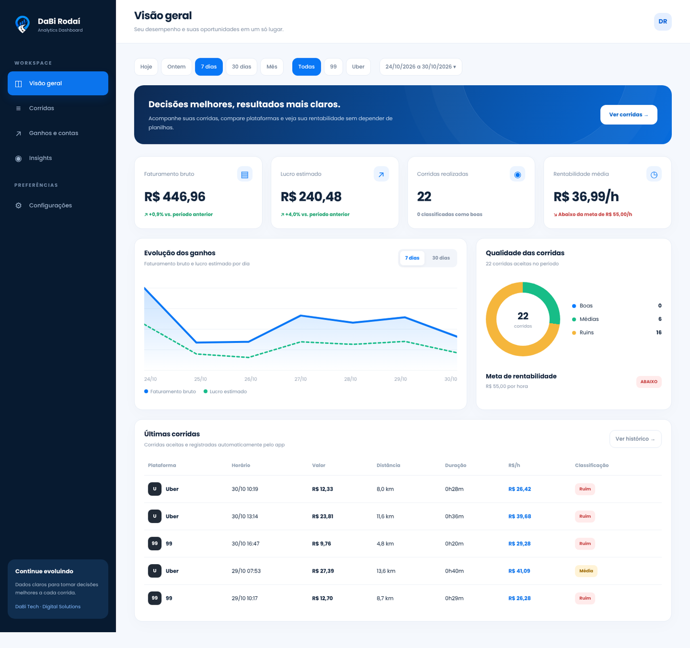
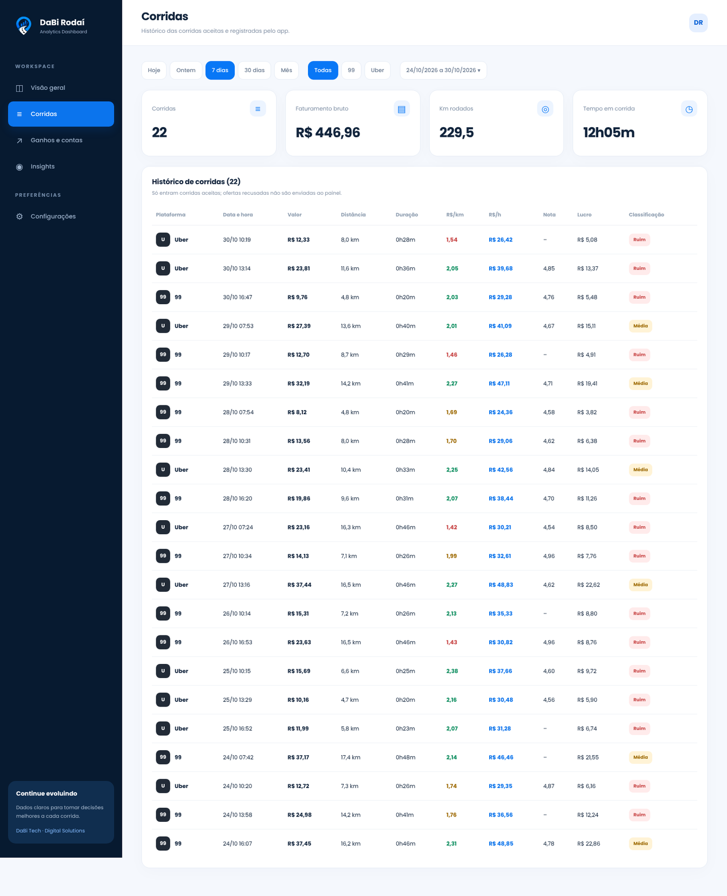
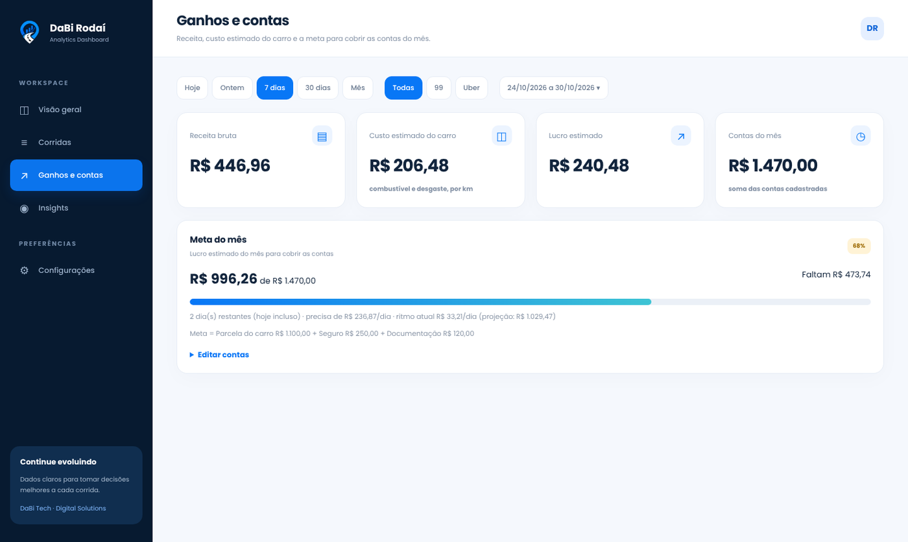
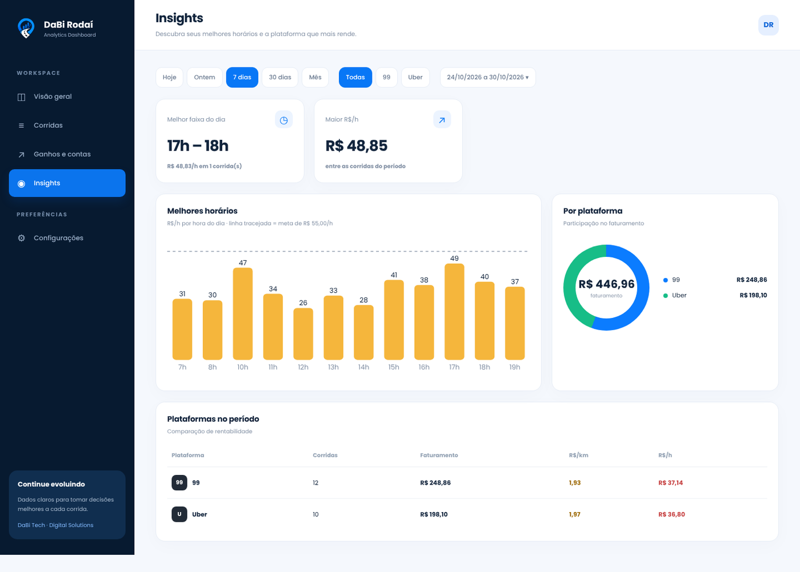
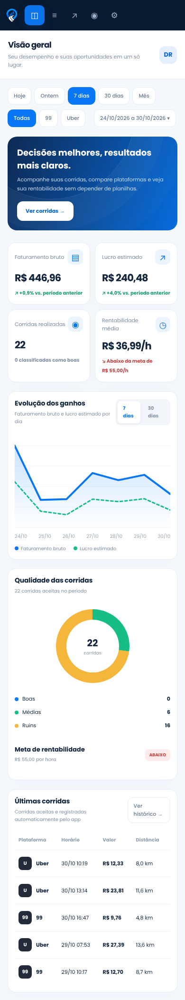
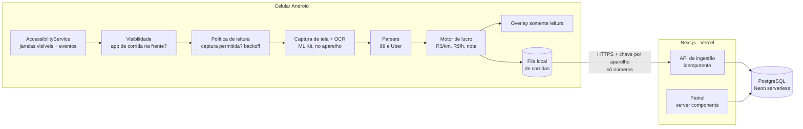

# DaBi Rodaí

**Copiloto financeiro para motoristas de aplicativo.** Um app Android que lê as ofertas de corrida na tela, mostra na hora se vale a pena (R$/km, R$/hora, lucro estimado, nota de 0 a 10) e um painel web que acompanha ganhos, rentabilidade e a meta do mês.

Projeto pessoal, feito por mim de ponta a ponta: produto, app Android, painel web, banco de dados e a engenharia de leitura de tela. Faz parte da [DaBi Tech](https://dabitech.com.br).

> 🔒 **O código-fonte é privado.** Este repositório documenta a arquitetura, as decisões técnicas e o processo. Posso apresentar o código em uma conversa técnica: [LinkedIn](https://www.linkedin.com/in/moysesemanuel/).
>
> As telas abaixo usam **dados fictícios**.

---

## Telas do painel

| Visão geral | Corridas |
|---|---|
|  |  |

| Ganhos e contas | Insights |
|---|---|
|  |  |

---

## O que faz

**No celular (Android)**
- Detecta quando o app de corrida está na tela e lê a oferta recebida por **OCR no próprio aparelho**.
- Mostra um painel compacto sobre a tela com veredito **boa, média ou ruim**, nota de 0 a 10, R$/km, R$/hora, R$/min e lucro estimado, com cores pelas metas do motorista.
- Aviso por voz opcional.
- Registra as corridas aceitas e envia ao painel online, com fila local para reenvio quando está sem internet.
- Telas do próprio app (Início, Corridas, Resumo, Ajustes) com faturamento do dia, última oferta analisada e meta diária.

**No painel web**
- Visão geral com comparação contra o período anterior, evolução de ganhos e lucro, qualidade das corridas e rentabilidade média.
- Histórico de corridas com filtros de período e plataforma.
- **Meta do mês** montada a partir das contas (parcela do carro, seguro, documentação) contra o lucro estimado, com ritmo diário necessário e projeção.
- Insights de melhores horários e comparação entre plataformas.

**Princípios**
- **Somente leitura:** o app nunca toca, aceita nem recusa nada nos aplicativos de corrida.
- **Privacidade:** o processamento é no aparelho. Saem do celular apenas números (valor, distâncias, tempos) e o nome da plataforma. Nenhum nome de passageiro, endereço ou texto de tela é enviado. O diagnóstico local registra só códigos e contadores.

---

## Arquitetura

Detalhes em [docs/arquitetura.md](docs/arquitetura.md). As decisões e os problemas reais que moldaram o projeto estão em [docs/decisoes.md](docs/decisoes.md).

---

## Stack

| Camada | Tecnologia |
|---|---|
| App | Kotlin, Jetpack Compose, AccessibilityService, `takeScreenshot`, ML Kit Text Recognition |
| Painel | Next.js (App Router, server components e server actions), TypeScript, SVG sem biblioteca de gráficos |
| Dados | PostgreSQL no Neon (driver serverless), transações para a meta |
| Infra | Vercel (deploy pelo GitHub) |
| Qualidade | 49 testes unitários de lógica pura (parsers, política de leitura, visibilidade, filtro do overlay) |

---

## Estado atual

Em uso e evolução. A leitura de ofertas, o motor de lucro, o envio ao painel e o painel web estão implementados. A refatoração mais recente da leitura de tela (três responsabilidades separadas) e as novas telas do app estão em validação no aparelho. Limitações conhecidas: o OCR erra caracteres com alguma frequência (por isso o parser confere redundâncias), a oferta da 99 não gera eventos de acessibilidade (por isso a leitura periódica) e apps de terceiros podem mudar a tela a qualquer momento.

---

## Aviso

Projeto independente. Não tem ligação com a Uber, a 99 ou qualquer outra plataforma citada, cujas marcas pertencem aos seus donos. Quem usa ferramentas assim deve conferir os termos de uso de cada plataforma.
